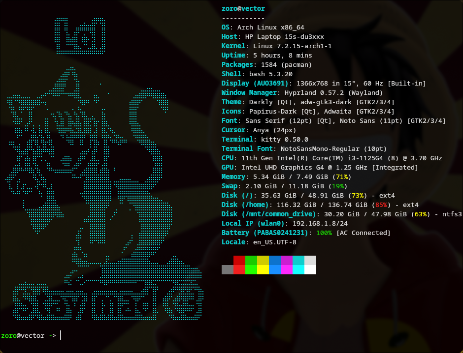

# ⚡ Vinayak's Dotfiles — Arch Linux + Hyprland

A modern, highly modular, and aesthetic Wayland desktop environment powered by **Arch Linux**, **Hyprland** (configured via modular Lua and Hyprlang), **Noctalia Shell**, **Waybar**, **Neovim**, and **Kitty**.

[](https://archlinux.org/)
[](https://hyprland.org/)
[](https://neovim.io/)
[](https://fishshell.com/)
[](https://github.com/Alexays/Waybar)
[](LICENSE)

---

## 📸 Screenshots Showcase

<!-- 
TIP: Drop your screenshots into an `assets/screenshots/` folder (or link to external URLs)
and update the paths below to showcase your desktop rice.
-->

<div align="center">

### 🖥️ Desktop Overview
<!-- Replace with:  -->


---

## 🧩 Desktop Stack & Architecture

| Component | Software | Description | Configuration Path |
|---|---|---|---|
| **Compositor** | [Hyprland](https://hyprland.org/) | Dynamic tiling Wayland compositor with modular Lua config | [`.config/hypr/`](file:///.config/hypr/) |
| **Status Bar** | [Waybar](https://github.com/Alexays/Waybar) | Customizable bar with animated bubbles, blush & minimal themes | [`.config/waybar/`](file:///.config/waybar/) |
| **Desktop Shell** | [Noctalia Shell](https://github.com/noctalia-dev) | Desktop widgets (notes scratchpad, kaomoji provider, hot-corners) | [`.config/noctalia/`](file:///.config/noctalia/) |
| **Application Launcher** | [Rofi-Wayland](https://github.com/lbonn/rofi) / [Wofi](https://hg.sr.ht/~scoopta/wofi) | Themed application menu and power state selector | [`.config/rofi/`](file:///.config/rofi/), [`.config/wofi/`](file:///.config/wofi/) |
| **Terminal** | [Kitty](https://sw.kovidgoyal.net/kitty/) | GPU-accelerated terminal with transparency and ligature support | [`.config/kitty/kitty.conf`](file:///.config/kitty/kitty.conf) |
| **Shells** | [Fish](https://fishshell.com/) & [Bash](https://www.gnu.org/software/bash/) | Fish as default interactive shell; Bash for scripting and login | [`.config/fish/`](file:///.config/fish/), [`.bashrc`](file:///.bashrc) |
| **Editor** | [Neovim](https://neovim.io/) & [Vim](https://www.vim.org/) | Lazy.nvim, Mason, LSP, Tree-sitter, Smear cursor, Saucelang | [`.config/nvim/`](file:///.config/nvim/), [`.vimrc`](file:///.vimrc) |
| **File Manager** | [Dolphin](https://apps.kde.org/dolphin/) & [Ranger](https://ranger.github.io/) | GUI KDE file manager + CLI Ranger with devicons & previewer | [`.config/ranger/`](file:///.config/ranger/) |
| **Lock & Idle** | [Hyprlock](https://wiki.hyprland.org/Hypr-Ecosystem/hyprlock/) & [Hypridle](https://wiki.hyprland.org/Hypr-Ecosystem/hypridle/) | Wayland lockscreen with battery/media widgets & idle management | [`.config/hypr/hyprlock.conf`](file:///.config/hypr/hyprlock.conf) |
| **Wallpaper** | [Hyprpaper](https://github.com/hyprwm/hyprpaper) + [Pywal](https://github.com/dylanaraps/pywal) | Dynamic wallpaper slideshow that generates accent colors for Lua | [`.config/hypr/script/wallpaper_slideshow.sh`](file:///.config/hypr/script/wallpaper_slideshow.sh) |
| **Notifications** | [Mako](https://github.com/emersion/mako) / [SwayNC](https://github.com/ErikReider/SwayNotificationCenter) | Lightweight Wayland notification daemon | [`.config/mako/config`](file:///.config/mako/config) |
| **Audio** | [PipeWire](https://pipewire.org/) & [WirePlumber](https://pipewire.pages.freedesktop.org/wireplumber/) | Pro-audio daemon with custom sound packs (Doom, One Piece, Mario) | [`sounds/custom/`](file:///sounds/custom/) |
| **Display Manager** | [SDDM](https://github.com/sddm/sddm) | Simple Desktop Display Manager with custom Slayer theme | [`sddm/setup.sh`](file:///sddm/setup.sh) |
| **Bootloader** | [GRUB](https://www.gnu.org/software/grub/) | Themed dual-boot with Windows 11 EFI chainloading | [`grub/setup.sh`](file:///grub/setup.sh) |

---

## 📁 Repository Structure

```text
dotfiles/
├── .config/
│   ├── fastfetch/            # Fastfetch hardware/system info banner configuration
│   ├── fish/                 # Fish shell config, custom functions (mountntfs, private)
│   ├── hypr/                 # Hyprland setup
│   │   ├── modules/          # Modular Lua configs (decorations, keyBind, hyprWindowRule, execute)
│   │   ├── script/           # Daemons (battery-monitor, network-monitor, wallpaper_slideshow)
│   │   ├── hyprland.lua      # Master Hyprland configuration entrypoint
│   │   ├── hyprlock.conf     # Lockscreen layout and widgets
│   │   └── hypridle.conf     # Idle detection & screen blanking rules
│   ├── kitty/                # Terminal emulator styling and fonts
│   ├── mako/                 # Notification daemon configuration
│   ├── noctalia/             # Noctalia shell plugins (scratchpad, kaomoji, inputmethod)
│   ├── nvim/                 # Neovim IDE setup (Lazy.nvim, Mason LSPs, Telescopes)
│   ├── ranger/               # Console file manager with custom devicons & scope.sh
│   ├── rofi/                 # Application launcher & power menu styling (.rasi)
│   ├── waybar/               # Status bar configs & themes (slanted-bubbles, blush, minimal)
│   └── wofi/                 # Fallback Wayland launcher
├── fonts/                    # Custom typography (Diphylleia-Regular.ttf)
├── grub/                     # GRUB bootloader theme & Windows 11 dual boot stanza
├── scripts/                  # Custom CLI productivity tools (oye, build-latex, ipconf, etc.)
├── sddm/                     # Greet Slayer theme installer for SDDM
├── sounds/                   # Custom system audio notifications (.ogg)
├── aur_pkgs.lst              # List of required AUR packages
├── packages.lst              # List of official Arch Linux packages
├── install.sh                # Automated master bootstrap installer
├── setup-sound.sh            # Sound & PipeWire configuration helper
├── report.html               # Interactive shell script audit & portability report
└── Readme.md                 # Project documentation (this file)
```

---

## 🚀 Installation & Setup

> [!NOTE]
> These dotfiles are portable and can be cloned into **any directory** (e.g. `~/dotfiles`, `/opt/dotfiles`, or `~/projects/dotfiles`). Destination symlinks will strictly resolve to `$HOME/.config`, `$HOME/.local/share`, and system paths.

### 1. Clone the Repository
```bash
git clone https://github.com/vinayakgupta29/dotfiles.git ~/dotfiles
cd ~/dotfiles
```

### 2. Run the Master Installer
The master installer bootstraps `yay`, installs system packages from [`packages.lst`](file:///packages.lst), installs AUR packages from [`aur_pkgs.lst`](file:///aur_pkgs.lst), links all configurations, and enables systemd services:
```bash
chmod +x install.sh
./install.sh
```

### 3. Display Manager Setup (SDDM)
To install the custom `greet_slayer` theme:
```bash
chmod +x sddm/setup.sh
./sddm/setup.sh
```

### 4. GRUB Theme & Windows 11 Dual Boot
To install the `albedo-grub-theme` and configure the Windows 11 UEFI chainloader:
```bash
chmod +x grub/setup.sh
./grub/setup.sh
```

### 5. Sound & PipeWire Setup
Verify sound output and enable PipeWire user services:
```bash
chmod +x setup-sound.sh
./setup-sound.sh
```

---

## ⌨️ Hyprland Keybindings

Hyprland is driven by `SUPER` (`Windows` key). Keybindings are configured via modular Lua in [`.config/hypr/modules/keyBind.lua`](file:///.config/hypr/modules/keyBind.lua).

### Core Applications
| Key Combination | Action | Command |
|---|---|---|
| `SUPER + T` | Open Terminal | Kitty |
| `SUPER + B` | Open Web Browser | Zen Browser |
| `SUPER + F` | Open File Manager | Dolphin |
| `ALT + SPACE` | Application Launcher | Rofi (`~/.config/rofi/style.rasi`) |
| `SUPER + ALT + P` | Power Menu | Rofi Power Menu (`shutdown`, `reboot`, `lock`) |
| `SUPER + W` | Network Connections | Kitty NMTUI |
| `SUPER + D` | Open Discord | Discord |
| `SUPER + COMMA` | Emoji / Emote Picker | Emote |
| `CTRL + ALT + DEL` | System Task Manager | Mission Center |

### Window Management & Layout
| Key Combination | Action | Description |
|---|---|---|
| `SUPER + Q` | Close Window | Gracefully terminates active client |
| `SUPER + SHIFT + F` | Toggle Floating | Toggle floating mode for focused window |
| `SUPER + P` | Toggle Pseudo-tile | Pseudo-tile window layout |
| `SUPER + H` / `L` | Column Navigation | Move focus across scrolling columns |
| `SUPER + SHIFT + H` / `L` | Swap Columns | Reorder columns left / right |
| `SUPER + MINUS` / `EQUAL` | Resize Column | Shrink / expand column width by 10% |
| `SUPER + C` | Fit Column | Auto-fit active column to screen |

### Session & Screenshots
| Key Combination | Action | Tool |
|---|---|---|
| `SUPER + SPACE` | Switch Input Language | Fcitx5 engine cycle (US, Japanese, Hindi) |
| `Print` | Screenshot Window | `hyprshot -m window` (saved to `~/Pictures/Screenshots`) |
| `SHIFT + Print` | Screenshot Region | `hyprshot -m region` (saved to `~/Pictures/Screenshots`) |
| `ALT + Print` | Screenshot Fullscreen | `hyprshot -m output` (saved to `~/Pictures/Screenshots`) |
| `SUPER + L` | Logout Session | `loginctl terminate-session` |
| `SUPER + SHIFT + R` | Reboot System | System reboot |
| `SUPER + END` | Power Off | System shutdown |

---

## 🛠️ Custom CLI Productivity Tools

Custom scripts are located in [`scripts/`](file:///scripts/) and can be linked to `~/bin/scripts` via [`scripts/setup.sh`](file:///scripts/setup.sh):

* **`oye`** — Fastfetch banner switcher. Displays beautiful ASCII art logos:
  ```bash
  oye ag4      # Ahegao anime banner
  oye sa       # Saitama / One Punch Man banner
  oye lu       # Luffy / One Piece wanted poster
  oye boy      # Boykisser banner
  oye --help   # Display all 15+ available logos
  ```
* **`build-latex`** — Professional LaTeX compilation tool. Compiles documents using `latexmk` inside an isolated `.latex-build/` sandbox:
  ```bash
  build-latex document.tex -o output.pdf
  build-latex clean
  ```
* **`clean-dependencies`** — Identifies and removes unneeded orphaned packages (`pacman -Qdtq`) and cleans the pacman package cache (`paccache -r`).
* **`find_commit_changes`** — Recursively scans a target directory for git repositories with uncommitted modifications or stashed changes.
* **`ipconf`** — Displays both local network IPv4 address and public internet IPv4 address with fast timeout handling.
* **`systemupdate`** — Wrapper that detects `yay`, `paru`, or `pacman` and performs a complete system upgrade.

---

## 🔒 Configuration Management & Privacy

### The "Local Include" Pattern (Keeping Personal Configs Out of Git)
Tools like **Opam**, **Gemini CLI**, **Cargo**, or private work tokens often inject environment variables into `.bashrc` or `.config/fish/config.fish`. To keep your tracked dotfiles clean and shareable:

1. **For Bash** — Append this to your [`.bashrc`](file:///.bashrc):
   ```bash
   if [ -f "$HOME/.bashrc.local" ]; then
       source "$HOME/.bashrc.local"
   fi
   ```
2. **For Fish** — Append this to your [`.config/fish/config.fish`](file:///.config/fish/config.fish):
   ```fish
   if test -f "$HOME/.config/fish/config.local.fish"
       source "$HOME/.config/fish/config.local.fish"
   end
   ```
3. Put personal tokens, machine-specific paths, and Opam init blocks inside `.bashrc.local` or `config.local.fish`.
4. These `.local` files are ignored by git in [`.gitignore`](file:///.gitignore).

### Ignoring Generated Directories Locally
To ignore local-only files (such as `.gemini/`, `.opam/`, `.vscode/`) without modifying the tracked `.gitignore`:
```bash
echo ".gemini/" >> .git/info/exclude
echo ".opam/" >> .git/info/exclude
```

### Auditing Shell Scripts
An automated health report analyzing all 34 shell scripts in this repository for cross-system portability, path issues, and syntax fixes is available in **[`report.html`](file:///report.html)**.

---

## 📜 License & Credits

* Configurations and scripts maintained by **Vinayak Gupta** ([@vinayakgupta29](https://github.com/vinayakgupta29)).
* Built with [Hyprland](https://hyprland.org/), [Noctalia](https://github.com/noctalia-dev), [Waybar](https://github.com/Alexays/Waybar), [Kitty](https://sw.kovidgoyal.net/kitty/), and [JaKooLit's](https://github.com/JaKooLit) Waybar inspiration.
* Licensed under the [MIT License](LICENSE).
